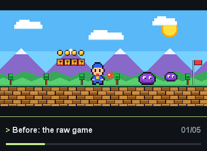
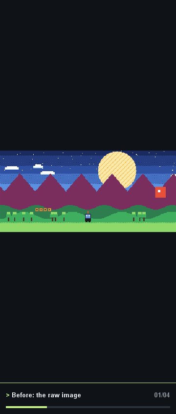
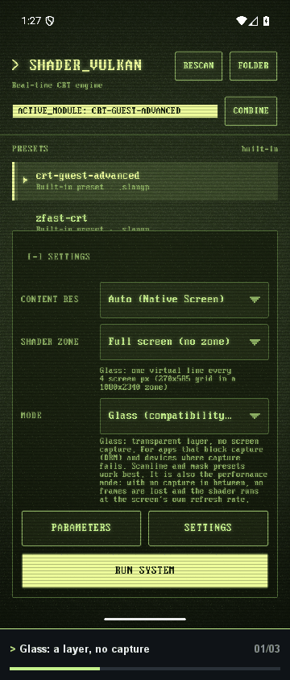
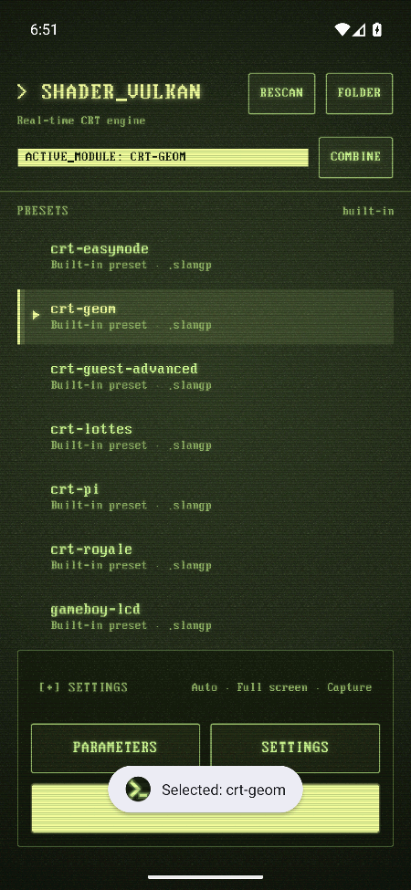

<div align="center">

# ShaderVulkan

### Real-time retro shaders over *any* Android app.

CRT scanlines, shadow masks, LCD grids and Game Boy screens on top of your emulators, games and videos.<br>
It runs the RetroArch **`.slangp`** shader presets you already know, on a Vulkan engine written for this app: **Capture** mode applies the real shader chain to your screen, and **Glass** is a lightweight overlay for protected apps.

[](#requirements)
[](#requirements)
[](LICENSE)
[](https://ko-fi.com/Eduzyrtin)
[](#privacy)
[](#features)
[](https://github.com/Eduzyrtin/ShaderVulkan/releases/latest)



**[Get it on Google Play](https://play.google.com/store/apps/details?id=com.sanabria.shadervulkan)** · **[Download the APK](https://github.com/Eduzyrtin/ShaderVulkan/releases/latest)** · [Getting started](#getting-started) · [How it works](#how-it-works-two-very-different-modes) · [FAQ](#faq)

> **Free here, paid on Google Play.** The APK on GitHub is completely free. If you'd rather install from the Play Store, that edition is the **paid version, as a way of donating** to the project: **[ShaderVulkan on Google Play](https://play.google.com/store/apps/details?id=com.sanabria.shadervulkan)**. Same app either way.

</div>

---

## Why this exists

RetroArch has hundreds of excellent shaders, but they only work **inside RetroArch**. On Android, most people actually play on standalone emulators (Dolphin, PPSSPP, DuckStation, NetherSX2, melonDS, Azahar, Eden…), on native ports, or on retro-style games from the Play Store, and none of those can run the slang presets.

ShaderVulkan sits on top of the whole system instead. In **Capture** mode it takes whatever is on screen, runs it through the real slang shader chain you choose and draws the result on top, **while your touches and controller input still reach the app underneath as usual**. You don't need root, and the app you're shading doesn't have to support anything.

And it has **no internet access at all**. It doesn't even request Android's internet permission, so the system won't let it connect to anything: nothing you see or do ever leaves your device.

<table>
  <tr>
    <td align="center"><br><sub>Before and after: the Authentic GBC shader</sub></td>
    <td align="center"><br><sub>Glass mode over any app</sub></td>
    <td align="center"><br><sub>The phosphor-terminal UI</sub></td>
  </tr>
</table>

## Features

### 🖥️ A real slang shader engine
- Loads **RetroArch `.slangp` presets** straight from a folder on your device: multipass chains, LUT textures, frame history, pass feedback, `#reference` presets, `#pragma parameter`, `#pragma format` and the usual `scale_type` / `filter_linear` / `wrap_mode` options.
- Heavy hitters like **crt-royale**, **crt-guest-advanced** and **koko-aio** compile and run on device.
- Shaders are compiled with glslang + SPIRV-Cross **in the background**, so the current shader keeps running while the next one builds. The results are cached on disk, so a preset you've used before loads almost instantly.
- **Combine presets**: stack a vignette after a CRT, a colour correction before it, and so on, without editing any files.

### 🎛️ Tweak everything live
- Every shader parameter is a slider you can move **while the shader is running**, from a small floating button that stays out of your way.
- Mark the parameters you use most as **favourites** and hide the other 40.
- Save the current values as **profiles** and switch between looks in one tap, or **export** them as a new `.slangp` that references the original.

### 🔲 Shade only what matters: the shader zone
- Limit the shader to a rectangle. Everything outside it (emulator buttons, skins, black bars) stays **untouched and sharp**.
- Set the zone by **aspect ratio** (4:3, 10:9, 8:7…), **drag it by hand** with handles, or let **AUTO** detect the content's black bars.
- More than 50 **console resolution profiles** (NES, SNES, Game Boy, Mega Drive, PS1, Neo Geo…), so the shader works at the original pixel grid.
- **One zone per orientation**, so portrait and landscape each keep their own.

### 🧱 Downscale the whole picture to the shader's grid
- In **Capture** mode the shader works at the **content resolution** you choose (CONTENT RES): Auto, a percentage of the screen (**Scale**, 10–100 %), a custom size, or a console grid.
- The whole captured picture is brought down to that grid before the shader runs, **not only the emulator's image**. For example, a 4K YouTube video with CONTENT RES at **25 %** is downscaled to a quarter of the screen, so it gets the same pixel look as the game, with the same aspect.
- Changes apply **live**, from the overlay menu (**OPTIONS → GRID**) or from the main screen, with no need to stop the session.
- Capture only reads the pixels the shader needs: with **Quality** or **Performance** capture, the system captures no more than the grid requires, which saves GPU and battery.

### 🎮 Made for Android handhelds
- **Dual mode**: two shader zones at once, for DS and 3DS emulators with both screens on one display.
- **Second-screen support**: on dual-screen handhelds such as the **AYN Thor**, the bottom screen gets its own shader, with its own zone editor and pixel-precise adjustment.
- **App profiles**: open an emulator and its shader turns on by itself, with the right preset, zone and mode. Leave it and the app asks whether to pause or close.
- **Auto-pause** when you pull down the notification shade, and auto-resume when you close it.

### ⚡ Fast, with a light footprint
- Zero-copy capture straight into Vulkan, mailbox presentation, and a reduced-capture option for weaker GPUs.
- Built-in **FPS counter** (screen refresh, input and output, frame times, dropped frames) that turns red when the shader can't keep up.
- **FPS cap** and a **battery mode** that lowers the load or pauses the shader below a battery level you choose.
- **Quick Settings tile** and launcher shortcuts to start your last shader without opening the app.

### 🟢 A UI that looks the part
- A phosphor-terminal interface with **73 colour palettes**, adjustable glow and film grain.
- An **in-app guide** explaining every permission and every mode in plain words.
- Available in **English, Spanish, French, German, Italian, Portuguese, Catalan, Basque and Galician**.

## How it works: two very different modes

ShaderVulkan has **two modes, and they are not the same thing**. Pick the one that fits what you're doing.

### 📸 Capture: the real shader, like in RetroArch
This is the main mode, and the one that runs the **actual RetroArch slang shader**:

1. Android lets the app **capture the screen** (you choose which app to share).
2. Every captured frame goes into the **full `.slangp` pipeline** on the GPU: all the passes of the preset, its LUT textures, frame history and feedback, with your parameters. It's the same idea as RetroArch's shader chain, except the input is the screen instead of an emulator core's output.
3. The processed frame is drawn **on top of the original app**, while touches and controller keep going to the app underneath.

Because the shader gets the real image, it can do **anything a slang preset can do**: colour, blur, bloom, curvature, NTSC… That is what lets crt-royale, crt-guest-advanced or koko-aio look as they do in RetroArch.

### 🪟 Glass: a lightweight overlay, no capture
Glass **does not capture the screen and does not run the shader on the image**. It draws a transparent layer on top of the app that imitates the structure of the preset: scanlines, shadow masks, LCD grids. Since it never sees the picture, a transparent layer can only **darken** it; it can't blur, bloom or recolour. In exchange it works where capture can't (Netflix, Disney+ and other DRM apps), asks for no screen-sharing permission and adds no delay, because the game image isn't touched.

> In short: **Capture is the star of the app: it is the full shader engine. Glass is the lightweight, compatible alternative, and you give things up with it.** Glass cannot reproduce every effect, and **not every shader parameter does something in Glass**: with no image underneath, the parameters that act on colour, blur, bloom, curvature or the picture itself have no visible effect there.

> **Android 13 or older: Glass only.** Capture needs **Android 14 or newer** (older versions only let you share the entire screen, and the shader ends up capturing itself). On Android 10 to 13, including handhelds such as the AYN Thor, ShaderVulkan works in **Glass mode only**, with the limits above.

## Two modes: Capture and Glass

|  | **Capture** (default, full shader) | **Glass** |
|---|---|---|
| How it works | Captures the screen and runs the **full slang shader chain** on the real image, as RetroArch would | Draws a transparent layer imitating the preset's scanlines, masks and grids, **without capturing anything** |
| What it can do | Everything: colour, blur, bloom, curvature, NTSC… | It can only **darken** the image, so scanlines, masks and grids look great; colour and blur effects don't apply |
| Netflix, Disney+ and other DRM apps | ❌ They block screen capture (black screen) | ✅ Works |
| Performance | Depends on the shader and the GPU | **Lossless**: runs at the display's own refresh rate |
| Permission prompt | Android asks you to share **one app** each session | None |
| Android version | **Android 14 or newer** | Android 10 or newer (the **only** mode on Android 10 to 13) |
| Shader parameters | All of them | Only those that darken or shape the mask; the rest have no visible effect |

> **Rule of thumb:** use **Capture** when you want the full shader, and **Glass** for protected apps, for maximum smoothness, or on devices where capture misbehaves.

> **Capture only supports sharing a single app.** When Android asks what to share, choose **"Share one app"**, never "Share entire screen". Sharing the entire screen is **not supported**: the shader ends up capturing itself and everything turns black. Android does not let apps remove that option, so all ShaderVulkan can do is warn you. (On Android 13 and earlier Android only offers the entire screen, so use **Glass** there.)

## Getting started

### Requirements
- Android **10** or newer, with a **Vulkan 1.1** GPU (practically any phone or handheld from the last five years).
- **Android 14 or newer for Capture**, the full shader mode. On Android 10 to 13 only **Glass** is available, and it can only darken the image (scanlines, masks, grids), so some shader parameters do nothing there.
- A copy of the **slang shaders**. They aren't bundled with the app; see step 4.

### 1 · Install the APK
Download the latest `ShaderVulkan-*.apk` from **[Releases](https://github.com/Eduzyrtin/ShaderVulkan/releases/latest)** and open it. Android will ask you to allow installs from your browser or file manager; allow it.

### 2 · Allow restricted settings (Android 13 and newer)
Android doesn't let sideloaded apps turn on an accessibility service until you allow it once:

1. Open **Settings → Apps → ShaderVulkan**.
2. Tap the **⋮** menu (top right) → **Allow restricted settings**, and confirm.

<details>
<summary>I don't see that option</summary>

The option only appears **after you've tried to turn the service on once**. Do step 3 first: Android will say the setting is restricted. Then come back here and the ⋮ menu will have it. On some Samsung and Xiaomi builds the menu is under *App info* rather than *Apps*.
</details>

### 3 · Turn on the overlay service
Open ShaderVulkan. The welcome screen explains why it needs accessibility (see [Privacy](#privacy)). Tap **ACCEPT**, then turn on **ShaderVulkan Overlay Service** in Android's Accessibility settings.

### 4 · Get the shaders
1. Download the official pack: **[libretro/slang-shaders → Code → Download ZIP](https://github.com/libretro/slang-shaders/archive/refs/heads/master.zip)**.
2. Extract it anywhere on your device, for example `Download/slang-shaders`.
3. In ShaderVulkan tap **FOLDER** and pick that folder.

### 5 · Play
Pick a preset (good first picks: `crt/crt-guest-advanced.slangp`, `crt/crt-lottes.slangp`, `handheld/gameboy.slangp`), choose **Capture** or **Glass** and tap **RUN SYSTEM**. Switch to your emulator; the floating button opens the menu with parameters, zone and pause.

## Privacy

- ShaderVulkan **does not have the Internet permission**. Android itself prevents it from sending anything anywhere. No analytics, no ads, no accounts.
- The **accessibility service** is used for exactly three things: drawing the shader on top while letting your touches through, knowing which app is in front (for app profiles), and noticing when the notification shade opens (to pause). It does not read or store the content of your apps.
- In Capture mode the screen image goes straight from Android to the GPU and onto your display. It is never saved or recorded.
- The full **[privacy policy](https://sites.google.com/view/sanabriaappsprivacypolicies/inicio)** covers every app published by Sanabria Apps.

## FAQ

<details>
<summary><b>Is this RetroArch? Why not just use RetroArch?</b></summary>

No. ShaderVulkan is an independent app with its own Vulkan engine. It reads the same **slang preset format** that RetroArch uses, so the libretro shader library works with it. It is not affiliated with or endorsed by libretro or RetroArch.

If you play inside RetroArch, you don't need this: RetroArch already applies its shaders there. ShaderVulkan is for everything else: standalone emulators, native ports and any app that can't run slang shaders on its own.
</details>

<details>
<summary><b>Does it look exactly like RetroArch?</b></summary>

The goal is to behave like RetroArch, and most presets look the same. It isn't guaranteed to be pixel-identical, though. The input is the captured screen rather than the emulator core's own output, so the emulator's scaling matters (use integer or nearest-neighbour scaling). A few preset features aren't supported yet, such as the `$PRESET_DIR$` wildcards in `#reference` paths.

If a preset looks different from RetroArch, that's a bug I want to hear about: [open an issue](https://github.com/Eduzyrtin/ShaderVulkan/issues) with the preset and a side-by-side screenshot.
</details>

<details>
<summary><b>What about input lag?</b></summary>

Your input isn't touched: touches and controller go straight to the game. **Capture** mode does add some display latency (the image has to be captured, processed and drawn again). It hasn't been measured rigorously yet, so there's no number to quote. **Glass** mode doesn't capture anything, so the game image isn't delayed at all.
</details>

<details>
<summary><b>Can I trust an APK from GitHub?</b></summary>

The app **has no internet permission**, so it cannot send anything anywhere, whatever it does. You can check this yourself with any APK inspector (for example App Manager): the permissions it asks for are overlay, screen capture, foreground service, notifications and storage reading for your shader folder. Only install it from this repository's Releases page.
</details>

<details>
<summary><b>Why does it need accessibility? That sounds scary.</b></summary>

Android only lets touches pass through a full-screen layer if that layer belongs to an accessibility service. Without it, the shader would cover the screen and you couldn't play. The [Privacy](#privacy) section lists exactly what the service does, and the app has no Internet permission to send anything even if it wanted to.
</details>

<details>
<summary><b>Why does Android ask me to share the screen every time?</b></summary>

That's Android's rule for screen capture, and only Capture mode needs it. **Always choose "Share one app"** (Android 14+), never the entire screen: sharing the entire screen is not supported, the shader would capture itself and everything turns black. Android doesn't let apps disable that option, which is why ShaderVulkan can only warn you. If you'd rather never see the prompt, or you are on Android 13 or earlier, use **Glass** mode.
</details>

<details>
<summary><b>I get a black screen on Netflix / Disney+ / some games.</b></summary>

Those apps block screen capture (DRM). Switch to **Glass** mode: it doesn't capture, so it works on top of them.
</details>

<details>
<summary><b>A shader is slow or the FPS counter turns red.</b></summary>

Some presets (crt-royale, for instance) are very demanding. Try, in order: a lighter preset, a smaller **shader zone**, a **console resolution** profile, **Reduced capture** in Settings, or **Glass** mode. The guide's *FPS counter* page explains how to read IN / OUT.
</details>

<details>
<summary><b>Does it work with my emulator?</b></summary>

If it shows up on screen, yes. ShaderVulkan doesn't integrate with any app; it works on whatever Android displays. Turn off the emulator's own filters and bilinear smoothing for the cleanest result, and use the zone so the shader only covers the game image.
</details>

<details>
<summary><b>Does it need root?</b></summary>

No.
</details>

<details>
<summary><b>Glass mode doesn't show bloom / colours / blur. Is it broken?</b></summary>

No, that's the hard limit of Glass. Without capturing the screen it can't see the image, it can only lay a mask on top, and a mask can only darken. Scanlines, shadow masks and LCD grids work well; bloom, blur, colour correction and NTSC effects can't, and the shader parameters that control them do nothing in Glass. For the full shader, use **Capture** (Android 14 or newer).
</details>

<details>
<summary><b>Will you add &lt;feature&gt;? What about iOS?</b></summary>

Ideas are welcome: [open an issue](https://github.com/Eduzyrtin/ShaderVulkan/issues) so they don't get lost in a comment thread. iOS doesn't allow apps to draw over other apps, so an iOS version isn't possible.
</details>

<details>
<summary><b>Will it drain my battery?</b></summary>

A GPU shader running at 60–120 FPS uses power, about the same as a demanding game. **Battery mode** and the **FPS cap** in Settings help; Glass mode is the lightest option.
</details>

<details>
<summary><b>Can I switch between the GitHub APK and the Play Store version?</b></summary>

They are signed with different keys, so one can't update the other. Uninstall first; your settings won't carry over.
</details>

## Found a bug? Have an idea?

Please open an **[issue](https://github.com/Eduzyrtin/ShaderVulkan/issues)** and include your device, Android version, the preset you were using and the mode (Capture or Glass). A screenshot of the FPS counter helps a lot with performance problems.

## Support the project

ShaderVulkan is a passion project and the APK here is **free**. If it brought your old games back to life and you'd like to give something back:

- ☕ **[Buy me a coffee on Ko-fi](https://ko-fi.com/Eduzyrtin)**
- ▶️ **[Get the Play Store edition](https://play.google.com/store/apps/details?id=com.sanabria.shadervulkan)**: the same app, offered there as a **paid version in donation format**, with automatic updates and no restricted-settings step.
- ⭐ Star the repo and share a screenshot or a clip. That helps as much as anything.

## Credits

- **[libretro slang-shaders](https://github.com/libretro/slang-shaders)** and their authors (Hyllian, guest.r, TroggleMonkey, Timothy Lottes, hunterk and many more) for the shaders this app exists to show off. Each shader keeps its own licence.
- **[glslang](https://github.com/KhronosGroup/glslang)** (BSD-3 / Apache-2.0 / MIT) and **[SPIRV-Cross](https://github.com/KhronosGroup/SPIRV-Cross)** (Apache-2.0) for shader compilation.
- The **RetroArch** project, for defining the slang shader format.

## Building from source

```bash
git clone --recursive https://github.com/Eduzyrtin/ShaderVulkan.git
```

Open the folder in **Android Studio** (it installs the NDK and the CMake 3.22.1 it asks for) and run the `debug` variant. `--recursive` matters because glslang is a git submodule. If you already cloned without it, run `git submodule update --init`.

## License

Copyright (C) 2026 Eduardo Sanabria.

ShaderVulkan is free software released under the **[GNU General Public License v3.0](LICENSE)**. You can use, study, share and modify it, and any modified version you distribute has to stay under the same licence. glslang and SPIRV-Cross keep their own licences (see the *About* screen in the app). The slang shaders aren't part of this repository; each one keeps its own licence.

<div align="center">
<sub>"RetroArch" and "libretro" are trademarks of their respective Eduzyrtins. ShaderVulkan is not affiliated with them.</sub>
</div>
